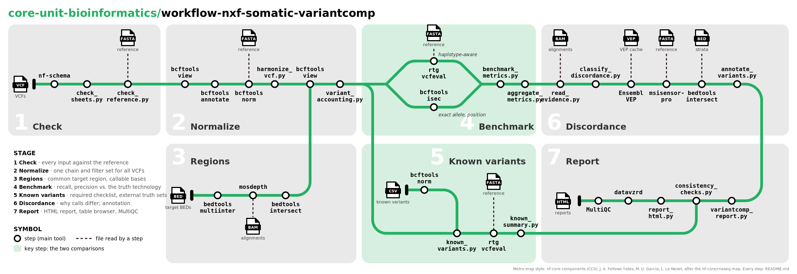

# core-unit-bioinformatics/workflow-nxf-somatic-variantcomp

> [!WARNING]
> Development version. Not yet validated on a full dataset (see the roadmap in
> [`docs/pipeline-plan.md`](docs/pipeline-plan.md)).

## Introduction

**workflow-nxf-somatic-variantcomp** compares somatic small-variant calls (SNVs and indels)
of the **same tumor/normal pairs** sequenced with **different technologies**
(e.g. WGS, WES, targeted panels). One technology is the ground truth for all samples.
The pipeline reports recall, precision and F1, and explains *why* variants differ
between technologies.

Unlike benchmarking pipelines that compare different callers on the same data
(e.g. nf-core/variantbenchmarking), here the input data differ. Meaningful numbers
therefore require:

1. Checking that every input is on the same reference genome, and harmonizing it
2. Identical normalization of all VCFs (split, left-align, atomize, deduplicate, tag
   harmonization) and identical filtering
3. Restriction to the intersection of all target regions and, if BAMs are given, to
   regions callable in all technologies
4. VAF-stratified, detection-power-aware metrics
5. Classification and annotation of every discordant variant (type, gene, repeat
   context, coverage, filter status, read evidence)

## Pipeline summary



The overview map shows the seven stages and the main tool of each step. The VCFs start
the pipeline on the left; every other file enters in the stage where it is used (target
BEDs and the known-variant sheet start their own line, files read by a single step such
as the reference FASTA reach it with a dashed line). The two comparisons are the key
step in the centre: the benchmark against the truth technology, where the line forks
into haplotype-aware matching (`rtg vcfeval`) and exact-allele/position matching
(`bcftools isec`), and the known-variant check below it.

The detailed map below lists every step with its number:


The map runs from top to bottom. Each grey box is a subworkflow, each row a step
(numbers as in the table below). Each coloured line starts at one input, runs through the
steps that process it and merges into the step that consumes it:

- **green — VCFs (always):** the central line. The VCFs of all technologies are checked,
  normalized, filtered identically, compared with the truth technology, classified,
  annotated and reported;
- **brown — reference FASTA:** indexed once; the dashed lines show where it feeds the
  checks, normalization, vcfeval and VEP;
- **blue — target BEDs:** checked, sorted and intersected into the common comparison
  region (`--regions_bed` / `--exclude_bed` refine it); merges into COVERAGE (or, without
  alignments, directly into the filter step 7.8);
- **orange — alignments (`--callable_regions`, `--read_evidence`):** callable regions
  restrict the comparison (step 7.8), read counts explain missed or extra calls (step 9.2);
- **pink — GIAB stratifications (`--giab_<name>`), `--stratification` and repeats:** genomic
  context of every variant (step 10.4);
- **red — VEP cache or GTF (`--vep`):** consequence, gene, impact (step 10.2);
- **yellow — `--known_variants`:** a required clinical checklist (PASS/FAIL per sample,
  technology and variant) or an external truth set; merges into the report.

Every step runs one tool (mostly nf-core modules) or one script of `bin/`; the options of
every step are set in `conf/modules/<subworkflow>.config`.

<!-- steps:start (generated: scripts/make_metro_map.py --markdown) -->

| Step | What happens | Tools | Line |
| --- | --- | --- | --- |
| **PIPELINE_INITIALISATION, CHECK_SAMPLESHEET** | _read and check the samplesheet_ | | |
| 1.1 | **Read the samplesheet, check every column.** The samplesheet is read as in the nf-core template: nf-schema checks every column (names, library types, file extensions). Relative paths are resolved against the samplesheet's directory; VCF and alignment indices are looked up next to the files. | `nf-schema` | VCFs of all technologies |
| 1.2 | **Check rows: truth technology, one BED per technology.** Rules across rows: every sample has the truth technology and another technology, no duplicate rows, one target BED and library type per technology, alignments where the options need them. All problems are reported at once with line numbers. | `check_sheets.py` | VCFs of all technologies |
| **PREPARE_REFERENCE** | _index the reference genome_ | | |
| 2.1 | **Unpack and index the reference FASTA.** A gzipped FASTA is unpacked and indexed; the `.fai` (contig names and lengths) is the reference every input is checked against. | `gunzip, samtools faidx` | Reference genome (FASTA) |
| 2.2 | **Genome BED: one interval per compared contig.** One interval per compared contig (the mitochondrial contig is left out unless `--keep_mito`); the comparison region of WGS-only runs. | `gawk` | Reference genome (FASTA) |
| **CHECK_INPUTS** | _check every input against the reference, before anything else_ | | |
| 3.1 | **VCFs: contigs, lengths, samples, REF alleles.** Contig names (safe renames chr/no-chr, MT/chrM), contig lengths (any difference is an error: another build), the tumor/normal columns and the REF allele of every record against the FASTA (`--max_ref_mismatch`). Switch off with `--check_vcf_contigs` / `--check_ref_alleles`. | `check_reference.py (pysam)` | VCFs of all technologies |
| 3.2 | **Alignment headers: contigs and lengths.** Contig names and lengths of every alignment header (`--check_bam_contigs`). | `check_reference.py (pysam)` | Alignments |
| 3.3 | **Target, regions and exclude BEDs.** BED format, contig names and interval ends of the target BEDs, `--regions_bed` and `--exclude_bed` (`--check_bed_contigs`). | `check_reference.py` | Target BEDs (+ --regions_bed / --exclude_bed) |
| 3.4 | **GIAB and stratification BEDs, --repeats_bed.** The GIAB genome stratifications given as `--giab_<name>` files, the `--stratification` sheet (columns, unique names, files) and every stratification BED; a precomputed `--repeats_bed`. | `check_sheets.py, check_reference.py` | GIAB (--giab_<name>) and other stratification BEDs, repeat regions |
| 3.5 | **Known-variant sheet and lists: positions, REF alleles.** The `--known_variants` sheet (columns, modes, samples, files) and every list: contigs, positions and REF alleles against the FASTA (`--check_known_variants`). Every later step starts only after all checks of 1.2 and 3.x passed. | `check_sheets.py, known_variants.py` | Known variants (--known_variants) |
| **PREPARE_ALIGNMENTS** | _index the alignments_ | | |
| 4.1 | **Index alignments without an index.** Alignments without a `.bai`/`.csi`/`.crai` next to them are indexed once. | `samtools index` | Alignments |
| **PREPARE_REGIONS** | _build the common comparison region_ | | |
| 5.1 | **Sort and intersect all target BEDs.** Every target BED is sorted, and only the bases targeted by every technology are kept (bedtools multiinter; WGS counts as genome-wide). | `bedtools sort, multiinter, gawk, merge` | Target BEDs (+ --regions_bed / --exclude_bed) |
| 5.2 | **Restrict to --regions_bed, remove --exclude_bed.** Optional: restriction to `--regions_bed` and removal of `--exclude_bed`. | `bedtools intersect, subtract` | Target BEDs (+ --regions_bed / --exclude_bed) |
| 5.3 | **Common region (genome if no BED) and its size.** The common comparison region (`regions/common_targets.bed`), merged, and its size per technology; it must have at least `--min_region_bp` bp. | `bedtools merge, region_summary.py` | Target BEDs (+ --regions_bed / --exclude_bed) |
| 5.4 | **Size of the region after every step.** Size of the comparison region after every step (genome, intersection of the target BEDs, `--regions_bed`, `--exclude_bed`), in bp and percent of the genome (`regions/common_targets.steps.tsv`). | `region_summary.py steps` | Target BEDs (+ --regions_bed / --exclude_bed) |
| **COVERAGE** | _find the bases callable in all alignments of a sample_ | | |
| 6.1 | **Common region in the alignment's contig names.** The common region is translated to the alignment's contig names (e.g. `1` instead of `chr1`). | `check_reference.py rename-bed` | Alignments |
| 6.2 | **Depth per base and per common-region interval.** mosdepth classifies every base as below or above the threshold and computes the mean depth per common-region interval (duplicates kept for amplicon libraries). | `mosdepth` | Alignments |
| 6.3 | **Callable bases per alignment (tumor / normal threshold).** Callable bases of each alignment: tumor depth ≥ `--min_coverage_tumor`, normal depth ≥ `--min_coverage_normal` (base mode; region mode uses the mean depth). | `mosdepth_callable.py` | Alignments |
| 6.4 | **Bases callable in all alignments of a sample.** Per sample: bases callable in every alignment of every technology, inside the common region (at least `--min_region_bp`). The sample is compared only there, so missing coverage in one technology is not counted as a miss. | `bedtools multiinter, intersect` | Alignments |
| 6.5 | **Depth in the common and the target region.** Depth of every alignment in the common region and in the target region of its technology (genome for WGS): mean and percent of bases ≥ each of `--coverage_thresholds`; also in the MultiQC section Coverage. | `mosdepth, coverage_summary.py` | Alignments |
| **PREPROCESS_VCF, NORMALIZE_VCF** | _normalize every VCF in the same way_ | | |
| 7.1 | **Keep tumor (+ normal) columns, recompress with BGZF.** Only the tumor (and normal) columns are kept, in this order; written as bgzipped VCF with index (inputs may be plain gzip). | `bcftools view` | VCFs of all technologies |
| 7.2 | **Split PASS and non-PASS records (--filter_pass_only).** With `--filter_pass_only` (default): PASS records (FILTER `PASS`/`.`) are compared; the other records go through the same steps so that the discordance step can name their FILTER. | `bcftools view` | VCFs of all technologies |
| 7.3 | **Rename contigs; remove other contigs and gVCF blocks.** Contigs are renamed to the reference names; records on other contigs (and the mitochondrial contig) and gVCF reference blocks are removed. | `bcftools annotate, view` | VCFs of all technologies |
| 7.4 | **Rewrite the contig header from the reference.** Contig header lines are rewritten from the reference index (adds missing contig lines). | `bcftools reheader` | VCFs of all technologies |
| 7.5 | **Split multiallelics, left-align, split MNVs, deduplicate.** Multiallelic records are split, indels left-aligned, MNVs split into SNVs, records whose REF differs from the FASTA and duplicates removed: the same representation for every caller. | `bcftools norm` | VCFs of all technologies |
| 7.6 | **Same VAF, depth, alt reads for every caller.** VAF, depth and alt reads are computed the same way for every caller (`--vaf_source`: FORMAT/AF, else AD) and stored as `VC_*` INFO tags; GT is set to tumor 0/1, normal 0/0. | `harmonize_vcf.py` | VCFs of all technologies |
| 7.7 | **All records together (PASS + non-PASS).** PASS and non-PASS records together: the normalized VCF that the discordance step searches. | `bcftools concat` | VCFs of all technologies |
| 7.8 | **Uniform filters; keep the common (or callable) region.** The same filters for every technology (`--min_vaf`, `--min_depth`, `--min_alt_reads`) and the comparison region: the common region, or with `--callable_regions` the sample's callable region. | `bcftools view` | VCFs of all technologies |
| 7.9 | **Records kept and removed per step and reason.** For every input VCF: records kept, removed (with the reason: non-PASS, contig, gVCF block, REF mismatch, duplicate, symbolic, region, VAF/depth/alt-read filter) and added by splitting, per step; every removed record; checks that the steps add up. | `variant_accounting.py` | VCFs of all technologies |
| **BENCHMARK** | _compare every technology with the truth technology_ | | |
| 8.1 | **Match calls haplotype-aware: TP, FN, FP.** Each technology is matched with the truth technology of the same sample, haplotype-aware, so different representations of one variant still match (TP, FN = missed, FP = only in the query). | `rtg vcfeval` | VCFs of all technologies |
| 8.2 | **Same-allele and same-position matches with their own metrics.** Record-by-record comparison by CHROM/POS/REF/ALT and by position only, with recall, precision and F1 of each method and the isec status of every variant (`benchmark/bcftools_isec_*`, `benchmark/metrics/`). | `bcftools isec` | VCFs of all technologies |
| 8.3 | **Recall, precision, F1 per sample (overall, type, VAF).** Recall, precision and F1 per sample and technology: overall, SNV vs. indel, by truth VAF (detection limit) and query VAF (low-VAF false positives), exact and position matches. | `benchmark_metrics.py` | VCFs of all technologies |
| 8.4 | **Combine samples: summed (micro) and mean (macro).** Over all samples: from the summed counts (micro) and as mean ± sd of the per-sample values (macro). Main result: `benchmark/metrics.aggregated.tsv`. | `aggregate_metrics.py` | VCFs of all technologies |
| **DISCORDANCE** | _explain why variants differ_ | | |
| 9.1 | **Read counts of every alignment at the compared variants.** With `--read_evidence` (default): reads supporting REF, ALT or another allele of every compared variant in every tumor and normal alignment (MQ ≥ `--evidence_min_mapq`; SNV bases with BQ ≥ `--evidence_min_baseq`; indels by their haplotype sequence, wherever the aligner placed them). | `bcftools query, read_evidence.py` | Alignments |
| 9.2 | **Reason for every FN/FP; detection power.** Each FN/FP gets exactly one main reason from the other technology's view: called but non-PASS, called but filtered by the uniform filters, or not called with low coverage, with alt reads, without alt reads, or without alignment; then germline evidence in the normal as a further reason. For truth variants, the binomial detection power gives the power-adjusted recall. | `classify_discordance.py` | VCFs of all technologies |
| **ANNOTATE_VARIANTS** | _annotate every compared variant_ | | |
| 10.1 | **Compared variants as sites VCF.** All compared variants of all comparisons as one sorted sites-only VCF. | `annotate_variants.py to-vcf` | VCFs of all technologies |
| 10.2 | **Consequence, gene, impact, variant class.** Ensembl VEP (offline; `--vep_cache` or `--vep_gtf`, options as in cio-abcd/variantinterpretation): the most severe consequence and its gene, impact, variant class and biotype per variant. | `Ensembl VEP, bcftools +split-vep` | VEP cache or GTF (--vep) |
| 10.3 | **Repeat regions of the reference.** msisensor-pro scans the reference for repeat (microsatellite) regions, or `--repeats_bed` is used (`--annotate_repeats`). | `msisensor-pro scan` | GIAB (--giab_<name>) and other stratification BEDs, repeat regions |
| 10.4 | **Repeat context and stratifications per variant.** Every variant gets its repeat unit and length and a yes/no per GIAB and stratification BED. | `bedtools map, intersect -c` | GIAB (--giab_<name>) and other stratification BEDs, repeat regions |
| 10.5 | **Merge all annotations into the variant table.** Result: `discordance/variants.annotated.tsv` (consequence group synonymous / non-synonymous / other, gene, impact, variant class, repeat, strata); the context of every FN/FP (indel, low VAF, repeat, strata) is added to its reasons. | `annotate_variants.py merge` | VCFs of all technologies |
| **PREPARE_KNOWN_VARIANTS, KNOWN_VARIANTS** | _check known variants_ | | |
| 11.1 | **Normalize the lists like the calls.** The checked known-variant lists are normalized like the calls (split, left-align, atomize). | `bcftools norm` | Known variants (--known_variants) |
| 11.2 | **Required: PASS/FAIL per sample and technology.** Required mode: each listed variant must be found in every technology of the sample: PASS, or FAIL as filtered, outside the comparison region or not called (with read evidence if available). | `known_variants.py check` | Known variants (--known_variants) |
| 11.3 | **Required: summary and recall over all samples.** Required mode: one table over all lists, samples and technologies with recall per technology, a warning per failed variant, optionally a stop (`--fail_on_missing_required`). | `known_summary.py` | Known variants (--known_variants) |
| 11.4 | **Benchmark: every technology vs the truth set.** Benchmark mode: every technology is compared with the external truth set inside its confident regions, with the metrics of the main benchmark. | `rtg vcfeval, bcftools isec, benchmark_metrics.py` | Known variants (--known_variants) |
| **REPORT** | _summarize_ | | |
| 12.1 | **Enrichment, gene and annotation tables, plots.** Are discordant variants enriched for indels, low VAF, non-synonymous consequences, repeats, strata or genes (Fisher's exact test, Benjamini-Hochberg from SciPy)? Discordance per annotation value, gene table, plots. | `variantcomp_report.py` | VCFs of all technologies |
| 12.2 | **Consistency checks of all counts.** At the end: do the counts of all steps add up (accounting per VCF, metrics vs. variant tables, aggregation over samples, discordance classes, regions, required variants)? `report/consistency_checks.tsv`. | `consistency_checks.py` | VCFs of all technologies |
| 12.3 | **Report sections and variant tables.** The variantcomp sections of the MultiQC report (summary cards, introduction, recall/precision per sample with a toggle of the matching method, truth variants found, known variants, why variants differ, discordant variants in detail, metrics per sample, region in Mbp, filtering, coverage, checks; vertical bars with the samples on the x-axis) and the linked variant tables of datavzrd (gene and HGVS.p first, coloured status columns, links to dbSNP, COSMIC, Ensembl). | `report_content.py` | VCFs of all technologies |
| 12.4 | **MultiQC report, table browser and zip.** MultiQC: the main report, results first, then the QC of every step (input checks, bcftools norm, harmonization, mosdepth, VEP) and the software versions; datavzrd: `report/tables/`, with the MultiQC report as a page; `report/variantcomp_report.zip` with both reports. | `MultiQC, datavzrd, report_bundle.py` | VCFs of all technologies |
| 12.5 | **Stop the run if a check failed.** A failed consistency check stops the run with an error, after all reports were written. | `consistency_checks.py gate` | VCFs of all technologies |

<!-- steps:end -->

All tools and datasets, with their authors and publications, are listed in
[`CITATIONS.md`](CITATIONS.md). Map and table are generated by `scripts/make_metro_map.py`
(`--outdir docs/images`, `--markdown`), the overview map by `scripts/make_metro_map_overview.py`
(`--outdir docs/images`).

Outputs are described in [`docs/output.md`](docs/output.md), parameters in
[`docs/usage.md`](docs/usage.md), HPC/offline use in [`docs/hpc.md`](docs/hpc.md) and testing
in [`docs/testing.md`](docs/testing.md). Planned further work is collected in
[`docs/roadmap.md`](docs/roadmap.md).

## Usage

The samplesheet is a comma-separated file with one row per sample and technology,
described in [`docs/usage.md`](docs/usage.md).

```bash
nextflow run core-unit-bioinformatics/workflow-nxf-somatic-variantcomp \
   -profile <conda/singularity/.../institute> \
   --input samplesheet.csv \
   --fasta genome.fa \
   --truth_technology wgs \
   --outdir <OUTDIR>
```

> [!WARNING]
> Please provide pipeline parameters via the CLI or the Nextflow `-params-file` option.
> Custom config files, including those provided by the `-c` Nextflow option, can be used
> to provide any configuration _**except for parameters**_; see the
> [docs](https://nf-co.re/docs/running/run-pipelines#using-parameter-files).

## Development

- Development environment: `conda env create -f envs/variantcomp-dev.yaml`
- Branches: `main` (releases), `dev` (development), `feat-*` (features, branched from
  `dev`). The history is kept linear.
- Test data (synthetic edge cases; SEQC2 HCC1395/HCC1395BL, WES + WGS) live in a separate
  repository and are prepared reproducibly with the scripts in `tests/`.
- Offline bundle for an HPC: `scripts/make_offline_bundle.py` (see `docs/hpc.md`).

## Credits

core-unit-bioinformatics/workflow-nxf-somatic-variantcomp was originally written by Kai Horny.

## Contributions and Support

If you would like to contribute to this pipeline, please see the
[contributing guidelines](docs/CONTRIBUTING.md).

## Citations

An extensive list of references for the tools used by the pipeline can be found in the
[`CITATIONS.md`](CITATIONS.md) file. A machine-readable citation is in
[`CITATION.cff`](CITATION.cff).

This pipeline uses code and infrastructure developed and maintained by the
[nf-core](https://nf-co.re) community, reused here under the
[MIT license](https://github.com/nf-core/tools/blob/main/LICENSE).

> **The nf-core framework for community-curated bioinformatics pipelines.**
>
> Philip Ewels, Alexander Peltzer, Sven Fillinger, Harshil Patel, Johannes Alneberg, Andreas Wilm, Maxime Ulysse Garcia, Paolo Di Tommaso & Sven Nahnsen.
>
> _Nat Biotechnol._ 2020 Feb 13. doi: [10.1038/s41587-020-0439-x](https://dx.doi.org/10.1038/s41587-020-0439-x).
