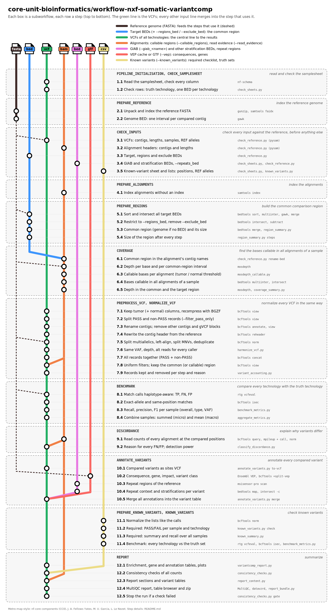

# core-unit-bioinformatics/workflow-nxf-somatic-variantcomp

> [!WARNING]
> Development version. Not yet validated on a full dataset (see the roadmap in
> [`docs/pipeline-plan.md`](docs/pipeline-plan.md)).

## Introduction

**workflow-nxf-somatic-variantcomp** compares somatic small-variant calls (SNVs and indels)
of the **same tumor/normal pairs** sequenced with **different technologies**
(e.g. WGS, WES, targeted panels). One technology is the ground truth for all samples.
The pipeline reports recall, precision and F1, and explains *why* variants differ
between technologies.

Unlike benchmarking pipelines that compare different callers on the same data
(e.g. nf-core/variantbenchmarking), here the input data differ. Meaningful numbers
therefore require:

1. Checking that every input is on the same reference genome, and harmonizing it
2. Identical normalization of all VCFs (split, left-align, atomize, deduplicate, tag
   harmonization) and identical filtering
3. Restriction to the intersection of all target regions and, if BAMs are given, to
   regions callable in all technologies
4. VAF-stratified, detection-power-aware metrics
5. Classification and annotation of every discordant variant (type, gene, repeat
   context, coverage, filter status, read evidence)

## Pipeline summary



Every step runs one tool (mostly nf-core modules) or one script of `bin/`; the options
of every step are set in `conf/modules.config`.

| Step | What is done | Tools |
| --- | --- | --- |
| 1. Input checks | samplesheet, stratification and known-variant sheets (cross-row checks); missing VCF/BAM indices are created | `check_sheets.py`, nf-schema, `bcftools index`, `samtools index` |
| 2. Reference | reference index, genome BED | `samtools faidx`, `gawk` |
| 3. Reference check of every input | contig names and lengths of VCFs, BEDs and BAMs; safe fixes (renaming, header lengths), errors on a build mismatch; REF-allele mismatch rate | `bcftools view -h`, `bcftools query`, `samtools idxstats`, `bcftools norm --check-ref`, `check_reference.py` |
| 4. Target regions | N-way intersection of all target BEDs, optional `--regions_bed` / `--exclude_bed` | `bedtools sort`, `bedtools multiinter`, `gawk`, `bedtools merge`, `bedtools intersect`, `bedtools subtract`, `region_summary.py` |
| 5. Coverage (optional, with BAMs) | depth per alignment; bases callable in all alignments of a sample | `mosdepth`, `mosdepth_callable.py`, `bedtools sort`, `bedtools multiinter`, `bedtools intersect` |
| 6. VCF normalization | tumor (+ normal) selection, contig renaming, gVCF block removal, contig header from the reference, split / left-align / atomize / deduplicate | `bcftools view`, `bcftools annotate`, `bcftools reheader`, `bcftools norm` |
| 7. Harmonization | VAF, depth and alt reads from FORMAT/AD (else AF + DP), variant type, GT | `harmonize_vcf.py` (pysam) |
| 8. Uniform filters | same filters and comparison region for every technology | `bcftools view` |
| 9. Comparison | haplotype-aware matching against the truth technology; exact-allele and position matches | `rtg vcfeval`, `bcftools isec`, `benchmark_metrics.py`, `aggregate_metrics.py` |
| 10. Discordance | read evidence at every compared position, class of every FN/FP, detection power | `bcftools query`, `bcftools mpileup` + `call`, `bcftools norm`, `classify_discordance.py` |
| 11. Annotation | genes and stratifications (repeats, homopolymers, ...) of every compared variant | `bedtools sort`, `bedtools map`, `bedtools intersect`, `annotate_variants.py` |
| 12. Known variants (optional) | required clinical variants (PASS/FAIL per technology), external truth sets | `known_variants.py`, `bcftools norm`, `bcftools isec`, `rtg vcfeval`, `known_summary.py` |
| 13. Statistics and report | enrichment (Fisher's exact test, Benjamini-Hochberg), gene table, plots, report | `variantcomp_report.py` (pandas, SciPy, Matplotlib), MultiQC |

All tools and datasets, with their authors and publications, are listed in
[`CITATIONS.md`](CITATIONS.md). The figure is drawn by `scripts/make_metro_map.py`.

Outputs are described in [`docs/output.md`](docs/output.md), parameters in
[`docs/usage.md`](docs/usage.md), HPC/offline use in [`docs/hpc.md`](docs/hpc.md) and testing
in [`docs/testing.md`](docs/testing.md).

## Usage

The samplesheet is a comma-separated file with one row per sample and technology,
described in [`docs/usage.md`](docs/usage.md).

```bash
nextflow run core-unit-bioinformatics/workflow-nxf-somatic-variantcomp \
   -profile <conda/singularity/.../institute> \
   --input samplesheet.csv \
   --fasta genome.fa \
   --truth_technology wgs \
   --outdir <OUTDIR>
```

> [!WARNING]
> Please provide pipeline parameters via the CLI or the Nextflow `-params-file` option.
> Custom config files, including those provided by the `-c` Nextflow option, can be used
> to provide any configuration _**except for parameters**_; see the
> [docs](https://nf-co.re/docs/running/run-pipelines#using-parameter-files).

## Development

- Development environment: `conda env create -f envs/variantcomp-dev.yaml`
- Branches: `main` (releases), `dev` (development), `feat-*` (features, branched from
  `dev`). The history is kept linear.
- Test data (synthetic edge cases; SEQC2 HCC1395/HCC1395BL, WES + WGS) live in a separate
  repository and are prepared reproducibly with the scripts in `tests/`.
- Offline bundle for an HPC: `scripts/make_offline_bundle.py` (see `docs/hpc.md`).

## Credits

core-unit-bioinformatics/workflow-nxf-somatic-variantcomp was originally written by Kai Horny.

## Contributions and Support

If you would like to contribute to this pipeline, please see the
[contributing guidelines](docs/CONTRIBUTING.md).

## Citations

An extensive list of references for the tools used by the pipeline can be found in the
[`CITATIONS.md`](CITATIONS.md) file. A machine-readable citation is in
[`CITATION.cff`](CITATION.cff).

This pipeline uses code and infrastructure developed and maintained by the
[nf-core](https://nf-co.re) community, reused here under the
[MIT license](https://github.com/nf-core/tools/blob/main/LICENSE).

> **The nf-core framework for community-curated bioinformatics pipelines.**
>
> Philip Ewels, Alexander Peltzer, Sven Fillinger, Harshil Patel, Johannes Alneberg, Andreas Wilm, Maxime Ulysse Garcia, Paolo Di Tommaso & Sven Nahnsen.
>
> _Nat Biotechnol._ 2020 Feb 13. doi: [10.1038/s41587-020-0439-x](https://dx.doi.org/10.1038/s41587-020-0439-x).
